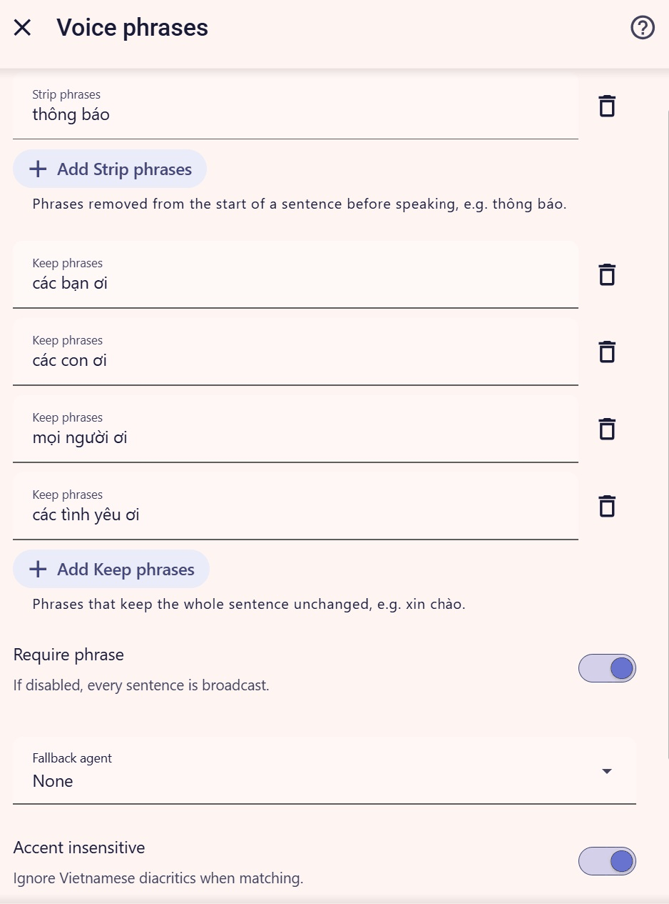
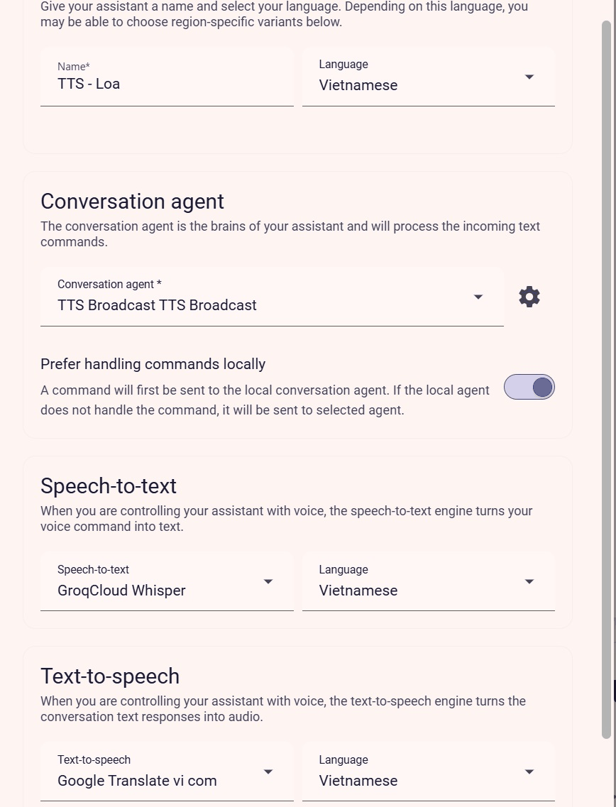
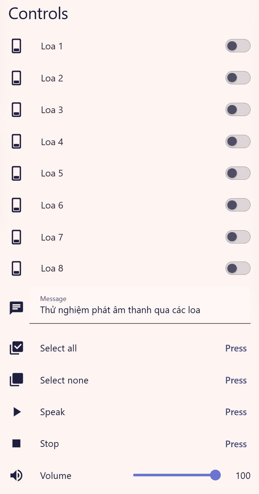

# TTS Broadcast

**[Tiếng Việt]** | **[English](./README.md)**

Một integration tùy chỉnh cho Home Assistant để phát thông báo TTS đến nhiều loa cùng
lúc. Chọn loa bằng công tắc, dùng chung một thanh trượt âm lượng, kích hoạt bằng giọng
nói qua Assist và điều khiển mọi thứ từ card dashboard — tất cả chạy cục bộ, bản thân
integration không phụ thuộc dịch vụ đám mây nào.

> **Lưu ý:** Repository hiện đang ở chế độ RIÊNG TƯ. Trong thời gian đó, hãy cài đặt
> thủ công bằng cách sao chép thư mục (xem mục Cài đặt). Không tự đổi chế độ hiển thị
> của repository; xem `PUBLISH_CHECKLIST.md` để biết quy trình phát hành.

## Integration này là gì và vì sao nên dùng

TTS Broadcast giúp bạn đọc một thông báo trên nhiều loa cùng lúc. Ví dụ quen thuộc là
câu thông báo tiếng Việt "thông báo, cơm chín rồi". Bạn cấu hình một hoặc nhiều loa
`media_player`, chọn những loa đang bật, đặt âm lượng chung, rồi nói hoặc gõ tin nhắn
qua Assist.

## Các tính năng và những gì integration cố ý không làm

**Tính năng**

- Đọc một tin nhắn đến nhiều loa cùng lúc.
- Công tắc bật/tắt cho từng loa (chỉ loa đang bật mới phát).
- Thanh trượt âm lượng chung ("Âm lượng ban đầu" chỉ là giá trị khởi đầu trước khi
  thanh trượt có trạng thái đã lưu).
- Kích hoạt bằng giọng nói qua Assist: một câu như "thông báo {message}" chỉ được đọc
  trên những loa đang bật.
- Card dashboard tùy chỉnh (`tts-broadcast-card`) với công tắc từng loa, âm lượng, tin
  nhắn, các nút Phát/Dừng/Chọn tất cả/Bỏ chọn tất cả và hàng TALK (Assist) có nhãn và
  biểu tượng được bản địa hóa.
- Dịch vụ: `tts_broadcast.speak`, `tts_broadcast.stop`,
  `tts_broadcast.get_dashboard_card`, `tts_broadcast.debug_selection`.
- Hoàn toàn cục bộ khi bạn dùng engine TTS cục bộ (ví dụ Wyoming); bản thân integration
  không phụ thuộc dịch vụ đám mây nào.

**Cố ý không làm**

- Không truyền giọng nói thật của bạn. Giọng nói được chuyển thành văn bản rồi đọc lại
  bằng TTS.
- Không có âm lượng riêng cho từng loa (chỉ một âm lượng chung).
- Không có giao diện frontend tùy chỉnh nào ngoài card.
- Không truyền âm thanh trực tiếp giữa các thiết bị.

## Yêu cầu

- Home Assistant **2026.11.0 trở lên** (đã chạy thử thực tế trên HA 2026.10.4 và mã
  nguồn 2026.11; các bản cũ hơn chưa được kiểm tra cục bộ).
- Một TTS entity (ví dụ `tts.wyoming_vietnamese`).
- Các loa `media_player` có thể phát TTS.
- Không bắt buộc: một engine STT nếu bạn muốn kích hoạt bằng giọng nói qua Assist.

## Cài đặt

### Cài thủ công (dùng được ngay; repository đang riêng tư)

1. Sao chép `custom_components/tts_broadcast` vào
   `config/custom_components/tts_broadcast`.
2. Khởi động lại Home Assistant.
3. Thêm integration từ Settings -> Devices & Services.

### HACS (chỉ sau khi repository được công khai)

1. HACS -> Integrations -> Custom repositories.
2. Thêm URL của repository này, chọn category "Integration".
3. Cài "TTS Broadcast" rồi khởi động lại Home Assistant.
4. Thêm integration từ Settings -> Devices & Services.

## Cấu hình

Toàn bộ cấu hình thực hiện trên giao diện (Settings -> Devices & Services -> TTS
Broadcast -> Configure).

| Trường | Ý nghĩa | Ví dụ |
|--------|---------|---------|
| TTS entity | Engine TTS dùng để đọc thông báo | `tts.wyoming_vietnamese` |
| Loa | Các loa `media_player` có thể phát thông báo | `media_player.phong_khach`, … |
| Loa không có điều khiển âm lượng | Các loa được loại trừ khỏi `volume_set` | `media_player.san_vuon` |
| Âm lượng ban đầu | Âm lượng khởi đầu trước khi thanh trượt có trạng thái đã lưu | `50` |
| Ngôn ngữ / Tùy chọn | Ngôn ngữ và tùy chọn (không bắt buộc) truyền cho TTS | `vi` / `{}` |
| Cụm từ bỏ đi | Cụm từ bị gỡ khỏi đầu câu trước khi phát | `thông báo` |
| Cụm từ giữ nguyên | Cụm từ giữ nguyên cả câu | `xin chào` |
| Bắt buộc cụm từ | Nếu tắt, mọi câu đều được phát | đã bật |
| Agent dự phòng | Agent Assist dùng khi không khớp cụm từ nào | một conversation agent khác |
| Không phân biệt dấu | Bỏ qua dấu tiếng Việt khi so khớp | đã bật |
| Văn bản trả lời | Câu xác nhận ngắn trả về Assist | `Đã gửi` |

Ví dụ về cụm từ: bỏ đi `thông báo` nên "thông báo, cơm chín rồi" chỉ đọc "cơm chín
rồi"; giữ nguyên `xin chào` nên "xin chào mọi người xuống ăn cơm" được đọc nguyên câu.

Bước **Cụm từ thoại** trong luồng tùy chọn:



## Entity và dịch vụ

Một thiết bị "TTS Broadcast" gồm một công tắc cho mỗi loa, một entity number âm lượng
dùng chung, một ô tin nhắn, các nút Phát/Dừng/Chọn tất cả/Bỏ chọn tất cả và một
conversation agent.

Mỗi lần thông báo, integration gọi `tts.speak` một lần cho từng loa đã chọn, chạy song
song: engine TTS tổng hợp lại cho mỗi loa (tốn thêm một chút) nhưng một loa lỗi không
chặn các loa khác, và các loa có thể bắt đầu lệch nhau vài mili giây.

### `tts_broadcast.speak`

```yaml
service: tts_broadcast.speak
data:
  message: "Cơm chín rồi, mọi người xuống ăn!"
  speakers: ["media_player.phong_khach"]  # không bắt buộc
  volume: 70                               # không bắt buộc, 0-100
  language: vi                             # không bắt buộc
  cache: false                             # không bắt buộc
  audit: true                              # không bắt buộc, chờ kết quả kiểm tra
```

Cấu trúc phản hồi: `{played, skipped, failed, errors, targeted, unexpected_started,
context_id}`.

- `played`: các loa mà HA đã nhận yêu cầu — **"đã nhận" không có nghĩa là đã nghe
  thấy**.
- `skipped`: các loa không khả dụng hoặc không xác định được.
- `failed`: các loa bị lỗi.
- `errors`: `{entity_id: nội dung lỗi ngắn}`.
- `targeted`: danh sách chính xác được gửi tới `tts.speak`.
- `unexpected_started`: các loa `media_player` bắt đầu phát dù không nằm trong danh sách
  đích (chỉ được điền khi `audit: true`; nếu không, xem `debug_selection`/diagnostics).

### `tts_broadcast.stop`

```yaml
service: tts_broadcast.stop
data:
  speakers: ["media_player.phong_khach"]  # không bắt buộc
```

### `tts_broadcast.get_dashboard_card`

```yaml
service: tts_broadcast.get_dashboard_card
data:
  notify: true
```

Trả về một đoạn YAML cho card entities có sẵn (đồng thời tạo thông báo lâu dài khi
`notify: true`).

### `tts_broadcast.debug_selection`

Không có tác dụng phụ, không phát gì. Trả về trạng thái từng loa, danh sách đã giải
quyết mà một lệnh `speak` không tham số sẽ dùng, mọi `media_player` đang coi một loa đã
cấu hình là thành viên nhóm, và bản kiểm tra của lần thông báo gần nhất. Dùng lệnh này
để chứng minh vì sao có thêm loa phát.

## Thiết lập giọng nói, từng bước (đọc phần cảnh báo trước)

**Cảnh báo:** đừng dùng pipeline Assist mặc định cho nút TALK. Pipeline mặc định thường
dùng agent LLM/Home Assistant, và HA sẽ chuyển thông báo đến
`assist_satellite.announce` trên TẤT CẢ vệ tinh Assist — nên mọi loa đều phát, không chỉ
những loa bạn đã bật.

1. Settings -> Voice assistants -> Add assistant.
2. Chọn conversation agent: **TTS Broadcast**.
3. Chọn engine STT và engine TTS của bạn.
4. Lưu pipeline. **Không** đặt nó làm pipeline mặc định.
5. Ghi lại id của pipeline.



Trong card dashboard, đặt `assist_pipeline_id` thành id đó. Hoặc để `auto` (mặc định):
card sẽ tự tìm pipeline có conversation agent là TTS Broadcast.

Nếu không có pipeline nào dùng agent TTS Broadcast, hàng TALK sẽ bị ẩn và một dòng thông
báo đã bản địa hóa sẽ nhắc bạn tạo pipeline.

## Card dashboard

Thêm card -> TTS Broadcast. Card tự phát hiện các entity của integration.



Tên loa trong ảnh chụp màn hình là tên thay thế, không phải tên thật.

Tùy chọn của card (tất cả đều không bắt buộc):

| Tùy chọn | Ý nghĩa | Mặc định |
|--------|---------|---------|
| title | Tiêu đề card | `TTS Broadcast` |
| show_volume | Hiện thanh trượt âm lượng | true |
| show_message | Hiện ô tin nhắn | true |
| show_assist | Hiện hàng TALK (Assist) | true |
| assist_pipeline_id | `auto`, `preferred`, `last_used` hoặc id pipeline cụ thể | `auto` |
| assist_name | Ghi đè nhãn nút TALK | `TALK` / `NÓI` |
| assist_icon | Ghi đè biểu tượng nút TALK | `mdi:microphone` |
| show_select_buttons | Hiện các nút Chọn tất cả / Bỏ chọn tất cả | true |

Phương án YAML dự phòng (card entities có sẵn):

```yaml
service: tts_broadcast.get_dashboard_card
data:
  notify: true
```

Sau khi cài đặt hoặc cập nhật, hãy tải lại trang (hard refresh) để trình duyệt nạp lại
JS của card.

Nếu không có pipeline Assist nào dùng agent TTS Broadcast, hàng TALK sẽ không được vẽ và
một dòng thông báo đã bản địa hóa sẽ hiện thay thế.

## Gỡ lỗi

| Vấn đề | Cần kiểm tra |
|--------|-------------|
| Tất cả loa đều phát khi tôi nói | Bạn đang dùng pipeline Assist mặc định (một agent LLM/Home Assistant chuyển thông báo đến mọi vệ tinh). Hãy tạo một pipeline riêng có conversation agent = TTS Broadcast và đặt `assist_pipeline_id` thành id của pipeline đó. Dùng Developer Tools > Events > `call_service` để xem ai đã gọi `assist_satellite.announce` hoặc `tts.speak`. |
| Không thấy nút micro | Pipeline cần một engine STT. Trang trình duyệt phải dùng HTTPS, hoặc dùng ứng dụng Home Assistant Companion. Hộp thoại chat riêng của conversation entity chỉ hỗ trợ văn bản, đây là thiết kế cố ý. |
| Một số loa phát nhỏ hoặc không phát | Kiểm tra thanh trượt âm lượng và âm lượng của chính loa. Các loa trong "Loa không có điều khiển âm lượng" không nhận `volume_set`. Thử phát trực tiếp trên loa bằng `tts_broadcast.speak`. |
| Có thêm loa phát | Gọi `tts_broadcast.debug_selection` và so sánh `targeted` với `unexpected_started`. Xem quy trình bên dưới. |
| Card không xuất hiện trong danh sách chọn | Tải lại trang (hard refresh) sau khi cài đặt/cập nhật. |
| Lỗi khi cấu hình | Kiểm tra bản dịch lỗi của phần tùy chọn (ví dụ "Chọn ít nhất một loa"). |
| Dừng không ngắt được phát trên một số loa ESPHome | Việc `media_player.media_stop` ngắt thông báo trên pipeline ESPHome chưa được kiểm tra (xem Giới hạn đã biết). |

### Có thêm loa phát — quy trình xử lý

1. Gọi `tts_broadcast.debug_selection` và đọc kết quả.
2. Bật đúng một công tắc, gọi `tts_broadcast.speak` với `return_response`, rồi so sánh
   `targeted` (danh sách chính xác gửi tới `tts.speak`) với `unexpected_started`.
3. Nếu `unexpected_started` trống và `targeted` chỉ có một entity nhưng các loa khác vẫn
   phát, nguyên nhân nằm **ngoài integration này**: kiểm tra Logbook xem ai đã khởi động
   các loa đó, liệt kê các automation/script gọi `tts.speak` hoặc
   `media_player.play_media`, và kiểm tra gói YAML cũ (script `loa_phat_tts`, automation
   "Assist - thông báo ra loa", `input_boolean.loa_*`).
4. Nếu `targeted` có nhiều hơn một entity, hãy gửi toàn bộ kết quả `debug_selection`,
   trạng thái các công tắc và các dòng log của integration.

## Giới hạn đã biết và tình trạng kiểm tra

| Mục | Trạng thái |
|------|-----------|
| Phát riêng từng loa (một loa lỗi không chặn các loa khác) | Đã kiểm chứng bằng kiểm thử tự động |
| Gọi `tts.speak` một lần cho mỗi loa, chạy song song | Đã kiểm chứng bằng kiểm thử tự động |
| Thanh trượt âm lượng là nguồn dữ liệu duy nhất | Đã kiểm chứng bằng kiểm thử tự động |
| `debug_selection` / kiểm tra / `unexpected_started` | Đã kiểm chứng bằng kiểm thử tự động |
| Card tự chọn pipeline Assist | Đã kiểm chứng bằng kiểm thử tự động (logic JS qua `node --check`) |
| Dòng HA 2026.11, loa `media_player` ESPHome | Đã kiểm chứng trên HA 2026.10.4 của tác giả |
| Pipeline Assist với TTS/STT Wyoming cục bộ | Đã kiểm chứng trên HA 2026.10.4 của tác giả |
| Hành vi loa Tapo | Chưa kiểm tra |
| Các engine TTS khác | Chưa kiểm tra |
| Các phiên bản HA khác | Chưa kiểm tra (khai báo tối thiểu 2026.11.0) |
| Ngắt thông báo ESPHome qua `media_stop` | Chưa kiểm tra |
| Trình chỉnh sửa trực quan trên frontend cho `assist_pipeline` | Chưa kiểm tra cục bộ (backend đã kiểm chứng) |

## Quyền riêng tư và bảo mật

- Nội dung tin nhắn không bao giờ được ghi log ở mức info.
- Không có telemetry, integration không thực hiện cuộc gọi mạng nào ra bên ngoài.
- Bất kỳ ai truy cập được pipeline Assist dùng agent TTS Broadcast đều có thể nói trên
  loa của bạn — hãy bảo vệ quyền truy cập pipeline.
- Không liên kết với và không được Home Assistant, Nabu Casa, Tapo/TP-Link, Zalo hay
  Google bảo trợ.

## Phát triển

```bash
ruff check .
ruff format --check .
pytest tests
```

Xem `CONTRIBUTING.md`, `SECURITY.md`, `CODE_OF_CONDUCT.md` và `PUBLISH_CHECKLIST.md`. Các
ảnh chụp màn hình dùng trong README này được liệt kê tại `docs/images/README.md`.

Giấy phép: MIT. Xem `LICENSE`.
